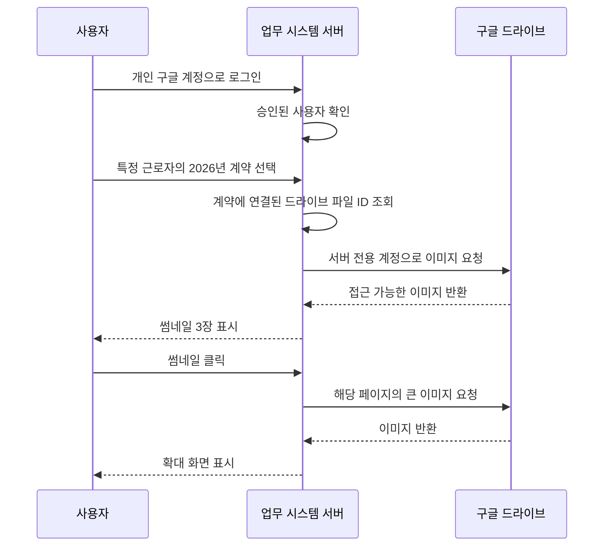

네. 다음 목표는 **“앱에서 근로자와 계약 연도를 선택하면, 드라이브의 계약서 이미지 3장을 바로 확인한다”**입니다.

현재처럼 사용자 3명이 동일한 계약서 자료를 확인하는 경우에는, **로그인은 개인별 구글 계정으로 하고, 드라이브는 서버가 지정된 계약서 폴더만 읽는 방식**을 우선 검토하겠습니다.

앞서 말씀드린 ‘사용자마다 드라이브 접근 동의 받기’ 외에, 서버 전용 계정으로 연결하는 방법도 있습니다. 사용자 경험을 단순하게 만드는 데 적합합니다.

**1. 실제 시스템에서는 어떤 순서로 동작하나요?**

서버 전용 계정은 **서비스 계정**이라고 합니다. 사람이 로그인해서 사용하는 계정이 아니라, 프로그램이 지정된 자료를 읽을 때 사용하는 계정입니다. Google은 파일·폴더를 이 계정의 이메일에 직접 공유하는 방식을 지원합니다. [Google 서비스 계정 안내](https://developers.google.com/workspace/guides/create-credentials)

제안하는 흐름은 다음과 같습니다.



여기서 중요한 점은 **계약 데이터와 이미지의 연결을 처음 한 번 만들어야 한다는 것**입니다.

| 보관 위치 | 보관할 내용 |
|---|---|
| 구글 드라이브 | JPG 원본 |
| Supabase DB | 계약 ID, 드라이브 파일 ID, 페이지 순서 |
| 사용자 화면 | 해당 계약의 썸네일·확대 이미지 |

이름만 같다고 자동 연결하면 동명이인이나 다른 연도 계약이 섞일 수 있습니다. 처음에는 담당자가 계약별로 3장을 확인해 연결하고, 이후 자동 연결을 검토하는 편이 안전합니다.

또한 썸네일 주소는 영구 주소가 아닙니다. Google의 썸네일 링크는 짧은 시간만 유효하고, 비공개 파일에는 인증이 필요하므로 **그 주소를 DB에 저장해 계속 사용하는 방식으로 만들지 않겠습니다.** 서버가 필요할 때 가져와 보여주도록 구성합니다. [Google 썸네일 설명](https://developers.google.com/workspace/drive/api/reference/rest/v3/files)

이 방식에서는 개인 사용자가 드라이브에 직접 접근하지 않아도 앱에서 볼 수 있습니다. 따라서 **앱에 허용된 세 사람이 연결된 계약서 전체를 봐도 되는지**를 먼저 정해야 합니다. 사람마다 볼 수 있는 자료가 다르다면 서버에서도 별도 권한을 검사해야 합니다.

**2. 드라이브에서 미리 준비할 일은 무엇인가요?**

먼저 용어를 확인해야 합니다.

- 개인 계정의 **‘내 드라이브’ 폴더를 함께 사용하는 것**
- Google Workspace의 **‘공유 드라이브’ 기능을 사용하는 것**

앞서 설명해 주신 환경은 첫 번째일 가능성이 있습니다. 실제 공유 드라이브는 조직 소유 구조이며 API에서도 추가 처리가 필요합니다. 어느 쪽인지에 따라 연결 설정을 맞추겠습니다. [공유 드라이브 설명](https://developers.google.com/workspace/drive/api/guides/about-shareddrives)

지금 준비할 작업은 다음 정도면 충분합니다.

| 준비할 일 | 이유 |
|---|---|
| 계약서가 들어 있는 최상위 폴더 확인 | 서버가 접근할 범위를 한정 |
| 테스트할 계약 2~3건 선정 | 전체 자료 연결 전에 검증 |
| 계약별 이미지와 페이지 순서 확인 | 다른 계약서 연결·순서 오류 방지 |
| 폴더 공유 상태 확인 | 공개 링크 없이 제한된 공유 유지 |
| 기존 파일·폴더 구조 파악 | 현재 구조를 활용해 이전 작업 최소화 |

예를 들어 새 자료부터는 이렇게 정리할 수 있습니다.

```text
근로계약서/
  직원관리번호_이름/
    2026년/
      01.jpg
      02.jpg
      03.jpg
```

**기존 4년 치 자료를 지금 전부 정리하거나 이름을 바꿀 필요는 없습니다.** 실제 폴더 구조를 보고 연결 방식을 정하면 됩니다. 파일명에 주민번호를 추가하는 것도 필요하지 않습니다.

개발 단계에서 제가 준비할 부분은 Google Drive API 활성화, 서비스 계정 구성, 서버 인증 처리입니다. 그 후 드라이브 소유자가 **계약서 폴더만 서비스 계정에 뷰어로 공유**하면 됩니다. 조직의 외부 공유 제한이 있으면 이 방식이 가능한지 먼저 시험해야 합니다.

서비스 계정 인증 정보는 서버에서만 관리합니다. 배포 환경이 지원한다면 장기 비밀 키를 만들지 않는 연결 방식을 우선 검토하겠습니다. [Google 인증 정보 관리 권장사항](https://docs.cloud.google.com/iam/docs/best-practices-for-managing-service-account-keys)

**3. 사용자는 어떻게 이용하고, 무엇을 주의해야 하나요?**

일반 사용자는 드라이브 연결 과정을 몰라도 사용할 수 있게 만드는 것이 목표입니다.

| 상황 | 사용자 경험 |
|---|---|
| 평소 계약 확인 | 로그인 → 근로자 → 계약 연도 선택 → 썸네일 확인 |
| 자세히 읽기 | 이미지 클릭 → 확대 → 이전·다음 페이지 |
| 아직 연결하지 않은 계약 | **계약서 연결 필요** 표시 |
| 파일이 삭제되었거나 접근 불가 | **계약서를 불러올 수 없습니다**와 다시 시도 제공 |
| 새 계약서 등록 | 담당자가 드라이브에 보관 → 해당 계약에서 이미지 연결·확인 |

일반 사용자에게는 **연결·저장소·API** 같은 기술 용어 대신, **계약서 보기 / 크게 보기 / 다음 장**처럼 행동이 명확한 버튼을 제공하겠습니다.

운영 담당자가 주의할 점은 다음입니다.

- 새 파일을 업로드한 것만으로 앱에 자동 연결되지는 않습니다. 최초 버전에서는 연결 확인이 필요합니다.
- 파일을 삭제하고 다시 올리면 새 파일 ID가 생기므로 재연결이 필요합니다.
- 다른 직원이나 다른 연도의 계약서를 연결하지 않았는지 저장 전에 확인합니다.
- 페이지의 계약 정보를 수정해도 서명된 JPG 내용은 바뀌지 않습니다. 두 자료가 다르면 확인이 필요하다는 사실을 구분해 보여줘야 합니다.
- 서비스 계정의 폴더 공유 권한을 제거하면 앱에서도 이미지를 불러오지 못합니다.

원본을 중복 저장하지 않아 Supabase 파일 저장 공간은 사용하지 않습니다. 다만 이미지를 서버를 통해 전달하므로 배포 서버의 전송량은 발생합니다. 썸네일은 작게, 큰 이미지는 클릭한 경우에만 불러오도록 설계하겠습니다.

다음 설계를 확정하기 위해 **드라이브 왼쪽 메뉴의 ‘공유 드라이브’ 아래에 자료가 있는지, 아니면 ‘내 드라이브’ 아래에 있는지** 알려주세요. 또 세 사용자 모두 전체 계약서를 열람해도 되는지도 확인하면 권한 구조를 정할 수 있습니다.
