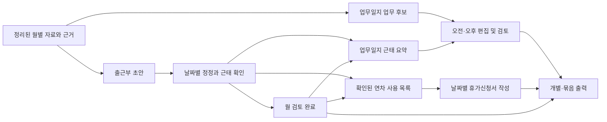

# 사회복지사 근무기록 제품 분석과 백오피스 통합 방향

분석일: 2026-10-19. 범위: 전달된 가상 데이터·명세·실제 모델/화면 코드·화면 스냅샷과 현재 백오피스 코드 비교. 제품 기능은 구현하지 않았다. 아래에서 **현재 동작**은 코드로 확인한 사실이며 **권고**는 통합 설계 제안이다. 센터의 실제 운영 절차와 문서 요구사항은 추가 확인 대상이다.

## 1. 이 프로젝트는 무엇인가

**한 명의 문서 작성 담당자가 근무 관련 자료를 검토하고, 사회복지사 출근부·업무일지·휴가신청서를 편집·출력하는 로컬 문서 작성 제품**이다. 세 화면은 출근부를 중심으로 연결된다.

현재 자료는 카카오톡 대화 등을 분석해 정리했던 결과를 재현하는 가상 데이터다. 전달본은 `attendance/data.json`과 점검표를 읽으며, **원문 수집이나 AI 분석 기능은 포함하지 않는다.** 대화 업로드만으로 서류가 만들어지는 서비스로 이해하면 구현 범위를 잘못 잡게 된다.

### 제품별 실제 역할

| 제품 | 입력과 편집 | 연결되는 정보 | 완료와 출력 |
| --- | --- | --- | --- |
| 출근부 | 월별 기본시간, 날짜별 출퇴근·인정시간·근무구분·서명·비고 | 시간·업무·방문·연차 관련 근거를 옆에서 확인 | 일자 확인과 월 검토 완료. 월 A4 한 장 출력, 초안 출력도 가능 |
| 업무일지 | 날짜별 오전·오후 업무, 비고·기타, 근거 후보 추가·이동·삭제 | 확인된 출근부 근태를 요약으로 반영 | 날짜별 검토 완료, 개별 및 월 검토 완료분 출력, 긴 내용 페이지 분할 |
| 휴가신청서 | 확인된 연차 날짜의 사유·연락처·대행자·신청일·시간 | 출근부의 연차 사용일을 연도별 조회 | 작성 완료, 날짜별 한 장 및 연간 작성 완료분 출력 |

출퇴근 시각과 인정 근로시간은 독립 입력이다. 예를 들어 09:00~18:00이라도 인정시간은 휴게·외출 등을 반영해 별도로 정정한다. 시각 차이를 그대로 인정시간으로 계산하면 원래 의도를 잃는다.

### 특히 구분해야 할 세 가지

1. 근거에 업무 흔적이 있다는 사실과 실제 출근·수행을 확인했다는 판단은 다르다. 평일 기본시간도 초안이다.
2. 업무일지의 시간대가 불명확하면 오전·오후에 임시 분배한다. 코드의 `placement=balanced`는 실제 시간대 확인을 뜻하지 않는다.
3. 휴가신청서는 **이미 출근부에서 확인한 연차 사용일의 서류 작성**이 출발점이다. 미래 휴가 신청 → 승인 → 사용 반영 절차는 없다. 작성 완료도 결재 승인이 아니다.

따라서 첫 통합의 적절한 제품 정의는 **사회복지사 근무기록 및 서류 작성**이다. 연차 발생·잔여, 급여, 전자결재까지 기대하게 만드는 명칭과 범위는 피하는 것이 좋다.

## 2. 사용자에게 어떤 편의를 주는가

### 문서 작성 담당자의 하루와 월말

기존에는 근무 자료 확인, 달력의 날짜·요일 입력, 출근부 시간 작성, 일지 작성, 연차 찾기, 신청서 재작성, 출력 대상 정리를 각각 해야 한다. 이 제품은 자료를 날짜별로 묶고 확인할 날짜를 드러내며, 같은 정보를 다른 서식에서 다시 입력하는 일을 줄인다.

예를 들어 3월 6일 연차 사용 흔적이 있으면 담당자는 출근부에서 근거를 보고 실제 사용 여부를 확인한다. 연차로 확정하면 출퇴근·인정시간은 비워지고 연차 목록에 등장한다. 그 날짜의 신청서는 이름·소속·직위·기본시간을 초안으로 가져오며, 담당자는 사유와 신청일 등을 채운다. 업무일지에는 근태가 반영되지만 기존 업무는 남아 있어 모순 여부를 직접 확인한다.

| 사용자 문제 | 현재 제품이 줄이는 일 | 남는 책임·한계 |
| --- | --- | --- |
| 어느 날짜를 확인해야 하는지 모름 | 확인 필요 날짜와 근거를 바로 연결 | 자료 없음이 곧 휴무/출근을 뜻하지 않음 |
| 서식마다 같은 기본정보 입력 | 기본값·근태 요약·연차 목록 재사용 | 기존 서류에 최신 정보가 자동으로 모두 반영되지는 않음 |
| 일지를 빈칸부터 작성 | 보고 내용에서 업무 초안과 후보 제공 | 수행 여부와 오전·오후 배치를 사람이 검토 |
| 연차 서류 누락 | 확인된 연차와 신청서 작성 상태 비교 | 등록된 자료 범위의 사용일만 집계, 잔여 계산 없음 |
| 한 장씩 출력하고 정리 | 검토/작성 완료 문서 묶음 출력 | 출력 대상·페이지·서명은 최종 확인 필요 |
| 수정 시 양식이 망가짐 | 정해진 서식 안에서 직접 수정 | 긴 문구와 브라우저별 출력 차이는 별도 검증 필요 |

장점은 자동 생성량보다 **확인할 곳을 좁히고 서류 완성까지 이어주는 것**이다. 통합 후에도 근거 확인, 직접 정정, 초안과 확인 상태 구분, 묶음 출력은 보존할 가치가 크다.

### 백오피스에서 기대할 수 있는 추가 가치 — 제안

- 담당 사회복지사가 본인 기록을 작성하고 운영자가 월말 누락을 모아 확인한다.
- 기관·직원 정보를 공통으로 관리해 이름·직위·기관명 반복 입력을 줄인다.
- 수급자 관련 실제 업무 기록을 일지 후보로 연결하면 업무일지를 다시 작성하는 부담이 줄어든다.
- 다른 PC에서도 같은 기록을 이어 작성하고, 월 마감 후 정정 사유와 이전 출력 내용을 확인한다.

다만 현재 백오피스의 수급자 등록·계획 수정 이벤트는 그 자체로 방문 수행이나 라운딩 완료를 증명하지 않는다. 향후 연계도 “일지에 추가할 후보”로 제시하고 사용자가 선택해야 한다. 현재 구현되어 있지 않은 라운딩 기능을 기존 데이터 원천으로 전제해서는 안 된다.

## 3. 현재 백오피스와의 접점과 충돌

### 3.1 제품 범위

README는 v1.0의 중심을 수급자 관리로 정의하지만 실행되는 `src/App.tsx`에는 수급자와 근로계약 메뉴가 이미 있다. 즉 문서의 최초 범위와 현재 기능 범위를 함께 봐야 한다. 이번 기능은 수급자 상세의 부속 서류보다 **직원 중심의 별도 업무 축**에 가깝다.

권고: 기존 메뉴에 `근무기록`을 추가하고 내부에서 `출근부 / 업무일지 / 휴가서류`를 전환한다. 첫 대상은 사회복지사로 한정한다. 요양보호사의 수급자별 서비스 실적과 급여로 곧바로 확장하면 근무 단위와 시간 산정 의미가 달라진다.

### 3.2 직원의 정체성이 아직 하나로 연결되지 않음

현재에는 Google 인증 사용자(`AuthUser`), 수급자 담당자(`BackofficeUser`), 근로계약의 근로자 정보가 각각 있다. 근로계약 묶음은 `getWorkerKey()`에서 주민등록번호가 13자리면 그 번호, 아니면 계약 ID로 구분한다. 전달본은 월/날짜만 문서 키로 사용하며 직원 ID가 없다.

그대로 붙이면 여러 직원의 같은 날짜 문서가 충돌하고, 계약 갱신 시 같은 사람의 기록이 분리되거나 로그인 계정과 작성 대상 직원이 혼동될 수 있다.

권고:

- 영속적인 `employeeId`를 도입하고 직원·계약·담당자·로그인 계정의 관계를 명시한다. 이름이나 주민등록번호를 새 기능의 공개 식별자로 쓰지 않는다.
- 근무 대상 직원과 실제 편집자를 별도로 저장한다. 관리자가 대신 작성하는 업무를 지원한다.
- 계약과 직원 연결은 기존 데이터 확인 후 매핑한다. 이름 일치만으로 자동 병합하지 않는다.
- 입사일과 계약 갱신 시작일을 구분한다. 갱신 때 과거 출근부가 입사 전으로 바뀌면 안 된다. 퇴사·재입사도 고려해 재직 기간을 정의한다.

### 3.3 근로계약은 약정, 출근부는 확인한 실적

기존 근로계약은 적용 기간, 요일·시간·휴게, 월 약정 상한 등을 관리한다. 기존 문서도 실제 실적·급여 계산과 구분한다. 전달본은 고정 기본시간과 입사일을 사용한다.

권고: 날짜에 유효한 직원 근무 설정 또는 계약에서 초안의 기준을 가져오되, 확정 실적과 분리한다. 기존 요양보호사 중심의 수급자별 조건 구조를 사회복지사 사무 근무에 강제로 적용하지 않는다. 공통 근무 설정이 필요한지 먼저 판단한다. 과거 기록에는 당시 적용한 기준을 남겨 계약 변경이 과거 문서를 다시 계산하지 않게 한다.

`monthly` 기준값과 입력시간 합계도 분리해야 한다. 제공 스냅샷의 월 소정 160시간/입력 합계 168시간은 서로 다른 값이 함께 표시될 수 있음을 보여준다. 이 예시만으로 초과근로·급여를 판정할 수는 없다.

### 3.4 로컬 저장과 중앙 저장

전달본은 서버 저장 API 없이 localStorage에 제품별 문서를 저장한다. 같은 origin에 연결되며 직원·계정별 격리가 없다. 현재 백오피스는 Google 로그인/허용 계정 검증 후 자체 API를 통해 Postgres에 접근하고 SQLite를 검증 옵션으로 둔다.

권고: 기존 인증 API 경계와 DB 구조를 따른다. localStorage의 정상 저장을 서버 저장으로 표시해서는 안 된다. `저장 중 / 서버 저장 완료 / 저장 실패 / 다른 사용자가 변경함`을 구분하고, 실패 시 입력을 보존한다. 기록 버전을 이용해 오래된 수정의 덮어쓰기를 차단한다. 기존 근로조건의 409 충돌 처리와 계획의 불변 이력 설계가 참고점이다.

JSON 복원도 기존 화면의 날짜별 덮어쓰기를 그대로 서버에 옮기면 안 된다. 대상 직원·기간 확인 → 유효성 검사 → 기존 기록과 차이 미리보기 → 적용 결과 기록 순서가 필요하다.

### 3.5 상태와 변경 전파

현재 `reviewed`와 `complete`는 제품별 의미가 다르고, 세 문서는 별도 저장된다. 출근부를 고친다고 다른 두 문서의 내용·상태가 일괄 재검증되는 구조는 아니다.

코드에서 확인한 구체적인 사례:

- 업무일지는 확인된 근태 요약 변경 시 `reviewed=false`로 돌아가지만 `pending`이나 확인 해제로 바뀐 근태는 `fillAttendance()`가 반영하지 않는다. 이전 요약이 남을 수 있다.
- 업무일지의 기존 상세 업무는 휴무·연차로 정정해도 삭제하지 않는다. 입력 보존에는 유리하지만 서로 모순되는 기록을 드러내야 한다.
- 휴가신청서는 날짜별 문서를 보존하며 출근부에서 연차를 취소하면 목록·출력 대상에서 빠진다. 같은 날짜를 다시 연차로 바꾸면 이전 작성 완료 문서가 재사용될 수 있다. 근태 재확인에 따른 신청서 재검토를 별도로 보장하지 않는다.

권고: `출근부 확인`, `일지 검토`, `신청서 작성`, `결재 승인`, `월 마감`을 별도 상태로 정의한다. 첫 버전은 앞의 세 상태와 필요한 월 마감만 도입하고 결재는 범위 밖으로 둔다. 문서가 참조한 근태 버전을 저장하고, 변경·확인 취소·연차 취소 시 관련 문서를 `재확인 필요`로 표시한다. 사용자 본문은 유지한다.

예: 확인된 연차를 출근으로 정정 → 신청서 출력 대상 해제 + 기존 신청서 이력 보존 + 일지 근태 재확인. 이미 출력한 서류가 있다면 재출력 필요 여부를 보여준다. 브라우저 인쇄창을 열었다는 이벤트만으로 실제 인쇄·PDF 보관 성공을 확정하지 않는다.

### 3.6 휴가의 업무 방향

| 선택 | 업무 방향 | 적합성 |
| --- | --- | --- |
| 과거·당월 서류 정리 | 근태 확인 → 연차 사용일 → 신청서 보완 | 전달본과 가장 가까움. 첫 도입 권고 |
| 미래 휴가 신청·승인 | 신청 → 승인/반려/취소 → 예정 → 사용 확인 | 별도 상태·권한·일정 설계 필요 |

두 흐름을 동시에 지원하려면 신청 건과 실제 사용 기록을 분리하고 상호 연결해야 한다. 휴가 신청이 승인됐다는 이유만으로 실제 사용까지 확정하면 안 된다. 반차·시간차, 연속 기간 신청, 발생·잔여 계산은 후속 범위로 나누는 것이 적절하다. 여기서는 법정 산정 기준의 적법성을 판단하지 않았다.

### 3.7 권한과 기록

로그인 가능한 사람과 다른 직원의 근태·휴가 사유를 읽거나 수정할 수 있는 사람은 같은 개념이 아니다. 기존의 로그인 허용 목록만으로 새 기능의 접근 범위를 결정할 수 없다.

권고: 최소한 본인 기록 작성자와 전체 기록 검토자를 구분하고, 대리 작성·마감 해제의 주체를 정한다. 서버에서 읽기·쓰기 범위를 검사하고 편집자·검토자·변경시각·정정 사유를 남긴다. 결재 기능을 넣지 않아도 기록 확인의 책임자는 필요하다. 실제 서명·직인 생성은 현재 기능에 없으며 이름 입력이나 완료 버튼을 전자서명으로 해석하지 않는다.

## 4. 화면과 스타일의 통합 방향

제공된 세 PNG를 확인했다. 전달본은 녹색 계열, 독립 상단 메뉴, 큰 안내 문구, 중앙 A4 서식과 우측 근거 패널이 중심이다. 백오피스 실행 화면의 스타일 코드는 연보라색 고정 사이드바, 회색 배경과 흰 카드, 목록·상세·입력 도구 중심이다. 백오피스 실제 브라우저 화면 비교는 이번 분석에서 수행하지 않았다.

권고는 **바깥 업무 화면은 백오피스 공통 스타일로, 안쪽 출력 서식은 기존 문서 특성에 맞게** 구성하는 것이다.

| 영역 | 권고 |
| --- | --- |
| 탐색 | 기존 사이드바 유지. 직원·월 선택을 세 탭에서 유지. 탭 이동 시 선택 날짜도 연결 |
| 주요 작업 | 직원·기간 → 누락/재확인 수 → 편집·근거 → 검토 → 출력 순으로 배치 |
| 화면 색상 | 기존 보라색은 선택·주요 동작에 사용. 확인 필요는 경고색과 텍스트/아이콘 병행 |
| 편집 | 날짜별 표 편집과 근거 패널 유지. 클릭 가능한 셀, 키보드 이동, 오류 위치를 명확히 표시 |
| 서식 | A4, 흑백 테두리, 결재·서명란, 페이지 분할 특성 보존. 백오피스 카드 스타일을 인쇄물에 강제하지 않음 |
| 좁은 화면 | 편집을 우선 표시하고 서식은 미리보기로 제공. 기존 244px 사이드바까지 포함한 가용 폭으로 검토 |
| 저장·출력 | 서버 저장 상태와 검토 상태 분리. 묶음 출력 전 대상·제외 사유·문서 수 확인 |

현재 스냅샷 수준의 화면은 1500px에서도 문서와 근거 패널을 함께 사용한다. 백오피스 사이드바를 추가하면 같은 배치를 유지하기 어려우므로 화면 너비별로 근거 패널 접기/아래 배치, 미리보기 전환을 설계해야 한다.

### 코드 스타일 충돌은 단순 색상 문제가 아님

전달본 CSS는 `:root`, `body`, `header`, `main`, `button`, `.brand`, `.header-actions` 등을 전역으로 지정한다. 일부는 기존 백오피스 선택자와 겹친다. 인쇄 CSS의 `main` 숨김과 `@page` 설정도 전역에 영향을 준다. 원본 CSS를 전역 import하면 기존 화면과 인쇄가 깨질 수 있다.

권고: React/TypeScript 화면으로 옮기고 CSS 범위를 한정한다. 출력은 별도 문서 전용 뷰/컨텍스트로 격리하며, 단순히 클래스만 감싸서는 격리되지 않는 `@page`와 전역 인쇄 선택자도 처리한다. 전달본의 직접 DOM 변경·전역 ID·`window` 이벤트를 React 상태 관리와 함께 중복 사용하지 않는다.

실행 진입점은 `src/main.tsx → AuthGate → App`의 Vite 흐름이다. 저장소에 Next 형식의 파일이 남아 있다는 이유로 새 기능을 `src/app`에 작성해서는 현재 실행 화면에 연결되지 않는다.

## 5. 무엇을 가져오고 무엇을 다시 설계할 것인가

| 판단 | 대상 | 이유 |
| --- | --- | --- |
| 보존 | 근거와 확정 구분, 확인 필요 탐색, 서식 직접 편집, 사용자 본문 보존 | 제품의 실질적인 업무 가치 |
| 추출·검증 후 재사용 | 근무구분/합계, 근태 요약, 날짜 검증, 일지 페이지 분할 | DOM과 분리된 모델에 유용한 로직이 있음. 통합 규칙·폰트·직원 식별에 맞게 보완 필요 |
| 새 설계 | 직원 식별, DB 저장, 접근 범위, 수정 충돌, 변경 전파, 마감 | 단일 브라우저를 전제로 한 구조로는 공동 운영을 지원하기 어려움 |
| 설정화 | 입사일 2024-10-24, 기간 2024-10~2026-10, 기본 선택일, 기관·직위·시설장 문구 | 원본 개인과 기관에 묶인 설정 |
| 초기 범위 밖 | 자동 AI 수집, 급여, 연차 발생·잔여, 전자결재, 모든 직군 확대 | 각각 다른 업무 규칙과 검증이 필요 |

별도 정적 사이트나 iframe은 원형 데모 확인에는 쓸 수 있으나 운영 통합의 주 구조로 권하지 않는다. 인증·직원 맥락·공유 저장·변경 전파를 연결하기 어렵기 때문이다. 또한 Git에서 제외한 `handoff`는 빌드·배포의 의존 경로로 쓰지 않는다. 향후 채택한 코드와 양식은 검토 후 정식 소스 위치에 반영해야 한다.

## 6. 권장 데이터 경계 — 확정 스키마가 아닌 설계 초안

| 개념 | 식별/내용 | 설계 의도 |
| --- | --- | --- |
| 직원 | `employeeId`, 기관, 직위, 재직 기간, 계정 연결 | 계약 갱신·이름 변경에도 동일인 유지 |
| 근무 기준 | 직원, 적용 시작/종료일, 요일·시간·휴게·휴무 설정 | 기준과 실제를 분리하고 적용 이력 유지 |
| 일별 근태 | 기관·직원·근무일, 근무구분, 시각, 인정시간, 확인자, 버전 | 문서 간 공유할 사실의 기준 |
| 월 검토/마감 | 직원·월, 상태, 검토자, 시각, 포함 기록 버전 | 일자와 월 상태 불일치 방지 |
| 업무일지 | 직원·날짜, 업무 항목, 시간대 근거, 사용자 메모, 참조 근태 버전 | 업무와 근태를 함께 보되 독립 편집 |
| 휴가서류 | 문서 ID, 직원, 대상 사용일, 사유·대행자, 작성 상태, 참조 근태 버전 | 사용일과 신청서 상태를 분리 |
| 근거 | 원천 구분, 발생일, 원천 식별/요약, 확인 결과 | 대화 후보와 실제 확인을 추적 |
| 문서 버전 | 당시 기본정보·서식 버전·내용, 생성자·생성시각 | 직원·기관 설정 변경 후에도 과거 서류 재현 |

현재 센터 단일 운영을 전제로 하더라도 기관 정보를 어디서 관리할지는 정해야 한다. 다기관 플랫폼 전체를 선행 구축할 필요는 없다. 휴가서류를 직원·날짜만으로 유일하게 고정하면 향후 동일 날짜의 시간차나 재신청에 제약이 생기므로 별도 문서 ID를 두는 편이 낫다.

월 검토 완료는 누락된 근태를 자동 확정하는 기능과 분리하는 것을 권한다. 원본에는 자료 없는 과거 날짜를 사용자 동의 후 평일 출근·주말 휴무로 채우고 확인 처리하는 기능이 있다. 통합에서는 `기본값 일괄 채우기`로 변경 대상을 먼저 보여주고, 실제 확인과 마감은 따로 수행해야 한다. 공휴일도 자동 판정하지 않는 현재 동작을 감안해 기관의 휴무 기준을 확인해야 한다.

## 7. 개발 전에 결정할 업무 질문

다음 항목은 코드만으로 확정할 수 없다. 아래 권고를 논의 출발점으로 삼되 실제 운영 규칙으로 간주하지 않는다.

| 우선순위 | 결정할 질문 | 권고 출발점 | 결정이 필요한 이유 |
| --- | --- | --- | --- |
| 필수 | 사회복지사 본인이 쓰는가, 담당자가 여러 명을 대신 작성하는가? | 본인 작성 + 검토자 대리 수정 지원 | 계정-직원 연결과 권한 결정 |
| 필수 | 목표가 과거 서류 보완인가, 일상 기록인가, 미래 휴가 승인인가? | 일상 기록과 과거 서류 보완을 우선 | 휴가 흐름과 데이터 모델 결정 |
| 필수 | 출근·시간의 최종 근거는 무엇이며 누가 확인하는가? | 직접 입력/원천 후보 + 지정 확인자 | 자동 초안이 확정으로 오인되는 것 방지 |
| 필수 | 사회복지사 직원 명부와 근무 기준을 어디서 관리하는가? | 영속 직원 식별 + 기간별 기준 | 근로계약/담당자와 중복 방지 |
| 필수 | 센터가 실제 사용하는 세 양식과 서명 절차는 무엇인가? | 현재 양식 실물과 대조 후 버전 확정 | 스냅샷은 가상 예시이며 현장 적합성 미확인 |
| 필수 | 월 마감 후 정정은 누가, 어떤 사유로 하는가? | 재개방 사유 및 관련 문서 재확인 | 과거 출력물과 현재 데이터 불일치 처리 |
| 후속 | 반차·시간차·연속 휴가를 언제 지원할 것인가? | 실제 사용 빈도를 확인해 별도 단계 | 단일 날짜 연차 모델의 확장 범위 결정 |
| 후속 | 기존 실사용 기록을 실제로 이관할 것인가? | 필요 기간과 대상 확정 후 별도 이관 | 전달본은 가상 데이터, 원본 브라우저 수정본 미포함 |

## 8. 실행 순서와 개발 착수 조건

### 먼저 업무 검증

센터에서 사용하는 실제 양식과 익명화한 한 달 사례로 아래 시나리오를 종이/화면 설계 수준에서 검토한다. 정상 출근만 있는 달보다 연차·휴무 변경·업무 흔적 부족·대리 작성·월말 정정이 포함된 사례가 좋다.

1. 직원과 기간을 고르고 당시 근무 기준으로 초안을 만든다.
2. 자료 없는 날짜, 주말 업무 흔적, 연차 후보를 직접 확인한다.
3. 업무일지의 시간대 미확인 업무를 정정하고 사용자 메모를 남긴다.
4. 연차 사용일의 신청서를 보완하고 작성 누락을 확인한다.
5. 월 검토와 출력 대상을 확인한다.
6. 연차를 출근으로 정정하고 일지·신청서·기존 출력물에 미치는 영향을 확인한다.

산출물은 대상 사용자/권한표, 상태 전이표, 직원 연결 규칙, 실제 양식 비교표, 한 달 시나리오다. 이것들이 정리된 후 기능 개발 티켓을 확정하는 순서를 권한다.

### 이후 개발 단계 제안

| 단계 | 범위 | 완료 판단 |
| --- | --- | --- |
| 1 | 직원 연결과 근무 기준, 인증 API 기반 일별 근태·출근부 | 두 직원의 같은 날짜가 분리되고 다른 PC에서도 저장값 유지. 과거 기준 유지, 동시 수정 차단 |
| 2 | 업무일지와 근태 연계 | 근태 변경/확인 해제 시 재확인 표시. 사용자 업무 보존. 시간대 미확인 노출 |
| 3 | 연차 사용 목록과 휴가서류 | 후보 출력 제외, 연차 취소/재지정 후 재검토, 기본값과 과거 문서 분리 |
| 4 | 월 마감·정정 이력·묶음 출력 및 필요한 실제 데이터 이관 | 마감 후 수정 통제, 정정 전후 확인, 대상 문서와 페이지 정확 |
| 후속 | 미래 휴가 신청·승인, 추가 원천 연계, 다른 직군 | 실제 필요와 별도 규칙을 확인한 후 범위 확정 |

세 화면을 동시에 복제하기보다 출근부의 기준과 확인 흐름을 먼저 안정화해야 한다. 단계는 구현 순서 제안이며 이번 분석에서 개발 착수나 DB 변경은 수행하지 않았다.

### 향후 수용 기준

- 자료 없음·예정·지시·시간대 임시 배치가 실제 수행 확정에 섞이지 않는다.
- 본인/대리 작성과 확인 책임자를 구분하고 다른 직원의 접근 범위를 서버에서 제한한다.
- 근태 수정·확인 취소·월 마감 해제로 파생 문서가 오래된 상태가 되었음을 알 수 있다.
- 기본 근무 기준이나 직원 이름을 바꿔도 과거 확정 서류가 조용히 바뀌지 않는다.
- 저장 실패와 충돌을 성공으로 표시하지 않고 입력 내용을 복구할 수 있다.
- 출근부 한 장, 긴 일지의 다중 페이지, 긴 휴가 사유, 묶음 대상과 서명란을 실제 지원 브라우저에서 확인한다.
- 초안/완료와 출력 가능 범위를 문서별로 정의한다. 기존처럼 개별 초안 출력을 허용한다면 초안임을 드러낸다.
- 실제 출력 시간이 얼마나 줄었는지, 누락 서류와 재입력 횟수가 줄었는지 한 달 시범 운영으로 비교한다. 정량 목표는 현재 작업시간을 측정한 후 정한다.

## 9. 이번 분석의 근거와 검증 한계

검토한 주요 자료:

- `handoff/README.md`, `manifest.json`, `specs/01-제품기획.md`~`03-이관과검증.md`
- 세 제품의 README, `model.mjs`, `app.js`, CSS와 세 PNG 화면 스냅샷
- 백오피스 `README.md`, `src/main.tsx`, `src/App.tsx`, `src/types.ts`, `src/auth.ts`, `src/styles.css`
- `src/lib/employment-contracts.ts`, `server/postgres/schema.sql`, `docs/employment-work-conditions.md`와 개발 운영 문서

`node handoff/product/check.mjs` 실행 성공: 25개월/761일 가상 데이터의 출근부·업무일지 모델, 확인된 연차, 달력 날짜 검증. 이는 전체 회귀 검사, 실제 인쇄 검증, 다중 사용자 검증이나 현장 적합성 검증을 대신하지 않는다. PDF 파일은 별도 페이지 단위로 검토하지 않았으며 실제 브라우저 편집/인쇄 동작도 이번에 재현하지 않았다.

`.gitignore`에 `handoff/`를 추가했고 `git check-ignore`로 적용을 확인했다. 최초 상태에서 해당 폴더는 미추적 상태였으므로 기존 추적 파일 제거는 필요하지 않았다. 분석 결과는 추적 가능한 이 문서에 남겼다.

현재 판단: **업무 흐름과 서식 자산은 도입 가치가 높다. 첫 도입은 사회복지사 근무기록·서류 작성으로 범위를 잡고, 직원 식별·확인 책임·중앙 저장·문서 재확인 규칙을 먼저 합의하는 것이 적절하다.**
